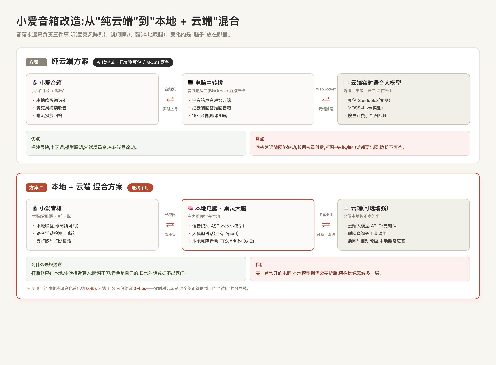

# 我把家里吃灰的小爱音箱"开除"了——给它换了一个自己的 AI 大脑

> 一次真实的智能音箱改造记录:不动一根焊线,让老音箱变成自己 AI 助手的耳朵和嘴。文末附完整 Step by Step。

## 一、家里那个音箱,其实一直"替别人打工"

家里的小爱音箱已经吃灰好久了。刚买回来那阵子,全家人都爱逗它——"小爱同学,今天天气怎么样""放一首周杰伦";新鲜劲儿一过,它就安安静静立在桌角,成了摆设。

直到我们开始做自己 AI 助手的时候,我盯着它,突然意识到一个问题:

**这台音箱,硬件其实相当能打。**

它有麦克风阵列,隔几米小声说话都能听见;它有喇叭,音质够用;它还带块屏幕;它一直连着网、接着电,就那么待着。

但它所有"聪明"的部分——你问的问题怎么理解、怎么回答、用什么声音说——全都不在它肚子里,而在小米的云端。它本质上是一个**很不错的"耳朵 + 嘴巴",顶着一个租来的脑子**。

于是我们决定:把脑子换掉。

## 二、先说结论:音箱的"智能",从来不在音箱里

改造之前,必须先建立一个认知,不然后面的操作全都没法理解。

你对着智能音箱说一句话,背后其实发生了三件事:

1. **听到**——麦克风把声音收进来,先在本地判断"是不是在叫我"(唤醒);
2. **听懂**——把语音转成文字、理解意思,这一步发生在**云端**;
3. **说出**——把答案合成语音播出来,音色和内容也大多来自**云端**。

所以"智能音箱有多聪明",和音箱本身关系不大,和它背后连着谁关系最大。

这也解释了很多人的困惑:为什么音箱宣传"支持 XX 大模型",实际用起来还是很笨?因为那句话的意思是"**它能联网调用别人家的云端服务**",不是"它肚子里装了个大模型"。一台几百块的音箱,肚子里那点内存和算力,塞不下任何能对话的 AI 模型——**能塞进去的只有"听到"和"发出声音"这两件小事**。

我们改造的思路就顺着这个现实来:**不跟硬件较劲,只换"大脑接线"**。让音箱继续干它擅长的——收音、播放;把"听懂和回答"这一段,接到我们自己的 AI 上。

## 三、动手之前,先回答一个要命的问题:你的型号是哪个?

这是我们踩的第一个坑,也是最容易劝退新手的坑。

网上搜"小爱音箱改造",教程一大堆,但很多互相矛盾。后来才明白:**小爱音箱不是一个型号,是一大堆硬件完全不同的设备**。机身底部标签上那串型号(比如 LX04、LX06、X08E),才是你真正要面对的东西。

我们手里这台是触屏款(LX04 这一类)。它本质上是一台**运行安卓系统的迷你平板,外加一圈麦克风和喇叭**。这一点决定了我们的路线:

- **带屏的型号**(LX04 / X08A / X08C / X08E 这类):本质是安卓设备,路子是"刷入改造版系统 → 打开开发者选项 → 想装什么装什么";
- **不带屏的型号**(LX06 / LX01 等):另一条完全不同的路子,通过替换固件补丁去"接管"音频链路。

**两批教程不能混用。** 抄错型号的教程,轻则白忙一场,重则音箱直接变砖。

还有一个更隐蔽的坑:同样是给 LX04 刷机,社区里有"官改固件"(社区为这个型号专门改的系统)和"国际版系统"两条路。国际版刷完系统确实更现代,但**小爱同学和米家全没了**,换来的是一堆在国内用不了的 Google 服务。如果你改造的目的就是"换掉大脑",那把原来的功能全丢掉反而无所谓;但如果还想留着回家模式、语音控制家电,国际版就是灾难。

我们选了官改固件:**保住底层能力,只替换大脑**。

## 四、刷机不是黑客行为,是拿回设备的控制权

很多人一听"刷机"就觉得门槛高、风险大。说实话,风险确实有,但它并不是什么神秘操作——本质上就三步:

1. **备份**:把原厂系统完整读出来存到电脑上(这是后悔药,没有它别往下走);
2. **写入**:把改造版系统刷进音箱;
3. **验证**:确认系统起来了、调试通道打开了。

先交代一个背景:**这场改造里,敲命令、下载校验固件、盯进度、查报错的活,九成是 AI Agent 干的**。我负责的是插线、按键、看屏幕、输密码这几类"手上动作"。把流程写成文字,是让你知道每一步在干什么——真到你自己操作时,Agent 会一步一步提示你该做什么,你不需要把命令背下来。

我们实际操作时,最花时间的不是"刷",而是"等"和"稳":

- 刷机工具会一直安静地等设备进入特定模式,界面上什么都不会显示。这时候千万别以为它卡死了去乱按——**先启动工具,再插线**,顺序不能反。
- 写入系统是按字节流慢慢灌进去的,比想象中慢得多。中途如果 USB 断了,不用从头重来,**从断点接着写**就行——这个细节能省下几十分钟。
- 最惊险的是刷完第一次开机:屏幕上跳出一行红色报错,**"系统启动异常 / 数据解密失败"**。那一刻真的会以为刷废了。但其实这是**预期内的正常现象**:新系统自带的"数据钥匙"和机器里原来的"锁"对不上,解不开用户数据而已。点一下屏幕上的"恢复出厂设置",系统立刻活过来,而且已经是我们自己的系统了。

刷成功的标志也很明确:进设置能看到之前不存在的"开发者选项",系统版本号变成了测试版标识,调试通道(adb)打开后能直接拿到最高权限。到这一步,这台音箱才真正"归你所有"。

## 五、最后一个反直觉的坑:让新 AI 上岗,得先让小爱"下班"

系统刷好了、也装上了自己的语音程序,结果发现:音箱里录到的全是零。

排查了半天才发现:**原厂语音助手会独占麦克风硬件**。只要小爱同学还在运行,别的程序就抢不到麦克风——能打开设备,但录到的全是静音。

所以这是一个**二选一**:要自己的 AI 听你说话,就得停掉原厂语音服务;想留着小爱同学,自己的 AI 就永远没有耳朵。没有"两个都要"的温和选项。

想明白这一点反而不纠结了——我们改造的目标本来就是"换大脑",小爱同学正是那个被换掉的旧大脑。让它体面下班,是计划之内的事。

停掉它之后,音箱里终于传来了真实的环境声。把音频流接到自己的语音识别和大模型上,再接回音箱的喇叭——

那一刻,家里那个吃灰的音箱,变成了一个**只属于你自己的 AI 助手**:叫它的名字,它应;问它问题,它用自己的方式回答;它的聪明,从此不在云端,而在你自己手里。

## 六、这场改造教会我的几件事

**1. "支持 XX 大模型"和"能跑大模型"是两回事。** 前者是联网调用,后者是本地运行,厂商文案从不区分。

**2. 智能硬件的"聪明"大多是租来的。** 你买的不是 AI,是一根通往别人 AI 的管子。改造的本质,是把管子的另一头接到自己家。

**3. 备份决定你敢不敢动手。** 分区备份做全了,刷机就是可逆的实验;没有备份,每一步都是在悬崖边上走。

**4. 报错不一定是失败。** 那行吓人的"数据解密失败",恰恰说明系统刷对了——它只是提醒你钥匙还没换。

**5. 改造前先想清楚要保留什么、放弃什么。** 目标模糊,路线必然拧巴。

**6. 好的 Agent 不是替你做完,而是让你敢做。** 固件校验、进度盯守、报错定位、下一步提示——它把专业门槛削平了,但按不按下"开始"按钮,决定权始终在人。

---

## 附:Step by Step 改造攻略(以小爱触屏音箱 LX04 类机型为例)

> ⚠️ **风险提示**:刷机有变砖风险,可能失去保修;请用家里"坏了也不心疼"的设备练手。操作前确认型号,型号不同步骤不同,本文仅适用于触屏安卓机型。

### 🙋 新手必读:下面这些步骤,不是要你一个人做完的

第一次看到这个清单,你可能会懵:又是固件又是分区备份,这哪是普通人玩的?

别慌。这份清单是一张**全景地图**,不是任务书。我们实际的做法,是**全程和 AI Agent 配合完成的**:

- **Agent 负责(占九成)**:生成并执行命令、下载并逐字节校验固件、实时监控刷机状态、每一步检查输出是否符合预期、出了问题自动定位原因、然后告诉你下一步做什么;
- **你负责(占一成)**:插线、拔线、按住按键、在屏幕上点"恢复出厂"、输 Wi-Fi 密码——全部是"手上动作",不需要看懂任何一条命令。

举三个例子,你就有体感了:

1. 刷机工具启动后会"安静地等设备接入",屏幕上什么都没有。自己操作很容易误以为卡死、然后乱按;Agent 会明确告诉你:"现在在等设备,请把 USB 线插上"——仅此而已;
2. 下载固件时,Agent 会按官方标注的**精确字节数**核对文件,残缺包根本进不了下一步;
3. 刷完第一次开机跳出红色报错"数据解密失败",自己遇到大概率以为刷废了;Agent 会提前告诉你这是预期现象,点"恢复出厂设置"就行。

所以正确的打开方式是:**把这篇攻略 + 你的音箱型号发给 Agent,让它当技师,你当助手**。它说什么,你做什么;它检查一切,你只动手。

### 第 0 步:确认型号与目标(你来做,5 分钟)

- 翻过音箱,看底部标签的 **Model** 字段(LX04 / X08E 等);
- 想清楚:要保留小爱同学吗?要接自己的 AI 吗?——这决定你选"官改固件"还是"国际版系统";
- 准备:一台电脑(Mac/Windows 都行)、原装电源、**一根可传数据的 USB 线**(很多线只能充电,插上没反应先换线)、稳定的网络。

### 第 1 步:下载官改固件 + 刷机工具(Agent 代劳)

> 🤖 Agent:检索对应型号的固件资源、下载、按精确字节数校验文件完整性。
> 🙋 你:只需提供音箱型号照片/型号文字,以及确认下载渠道是社区可信来源。

- 从社区渠道(如相关开源项目的资源站)下载**对应本机型号**的官改固件包;
- 下载刷机工具(如 mtkclient 这类联发科平台工具);
- **校验文件**:对照官方页面标注的文件大小,别下到残缺包。

### 第 2 步:完整备份原厂系统(最重要的安全网)

> 🤖 Agent:驱动刷机工具逐分区读出数据、按"分区名 + 大小"逐个断言核对。
> 🙋 你:按 Agent 提示插线、让设备进入刷机模式;备份完成后把它**另存一份到移动硬盘**。

- 让音箱进入刷机模式(按工具提示插线、按键);
- 用工具把全部分区**逐一读出并保存**到电脑;
- 备份文件**另存一份到移动硬盘或网盘**——存在同一台电脑上不算备份。

### 第 3 步:刷入官改固件(Agent 主刷,你管插线)

> 🤖 Agent:执行逐分区写入;USB 中断时从断点续传,不重来;全程盯写入进度。
> 🙋 你:按提示插线/拔线;工具"安静等待"时不要乱动,听 Agent 指挥。

- 先启动刷机工具,再按提示连接设备(工具会一直等待,属正常);
- 逐分区写入;**中途 USB 断开不要慌**,从断点继续写,不必从头重来;
- 写完不要急着拔线。

### 第 4 步:第一次开机——看到报错别慌(你来点按钮)

> 🤖 Agent:提前告知这个报错是预期现象,并教你怎么确认刷机成功。
> 🙋 你:插电源开机、看屏幕、点"恢复出厂设置"。

- 接电源开机,若出现"**系统启动异常 / 数据解密失败**",这是新系统与旧数据的钥匙不匹配,**属预期现象**;
- 按屏幕提示点"**恢复出厂设置**",等待系统自动初始化;
- 刷成功的硬指标:系统版本显示为开发版/测试标识,且设置里出现"**开发者选项**"。

### 第 5 步:打开调试通道,改用 WiFi 联调(Agent 操作,你输密码)

> 🤖 Agent:执行 adb 命令、读取设备信息、验证 root 权限是否就位。
> 🙋 你:在音箱屏幕上打开"USB 调试"开关;输一次 Wi-Fi 密码。

- 在开发者选项里打开 **USB 调试**;
- 用数据线连接电脑,确认设备被识别;
- 执行 `adb tcpip 5555` 开启网络调试,之后音箱插回原装电源,电脑通过 **WiFi 无线连接**音箱——从此不用反复插拔;
- 验证权限:此时应能直接获得 root 权限(官改固件自带,无需额外破解)。

### 第 6 步:让自定义 AI 接管"耳朵和嘴"(Agent 搭链路,你验收)

> 🤖 Agent:处理音频采集、滤波、接语音识别/大模型/语音合成的全部技术环节;遇到"录到全零"这类问题自己排查。
> 🙋 你:对音箱说话,验收"喊一声、它应答"的效果。

- **停掉原厂语音助手**(注意:这一步之后小爱同学下线,二者不可共存),释放麦克风;
- 用 `tinycap` 等工具从 ALSA 层直接采集麦克风音频(绕开应用权限限制);
- 采集参数建议:单声道、16kHz、16bit;**注意原始音频带直流偏置,需做一阶高通滤波**,否则后面的静音检测会全部失效;
- 将音频流接入你的语音识别 → 大模型 → 语音合成链路,合成结果回推到音箱喇叭播放。

### 第 7 步:验收清单(Agent 自检,你体验)

> 🤖 Agent:逐项核对下面的清单,把关键状态截图/读数发给你。
> 🙋 你:实际喊一声音箱,感受"叫它名字 → 它应答"的完整体验。

- [ ] 音箱可正常开机进入新系统
- [ ] 开发者选项存在,adb 可无线连接
- [ ] 麦克风能采到真实人声(非全零)
- [ ] 对音箱说话 → 本地唤醒 → 后端识别 → AI 回答 → 喇叭播出,全链路走通
- [ ] 断网时的降级表现符合预期(至少本地唤醒仍有反应)

---

## 七、一图看懂:我们试过的两条路线

方案一是初代尝试,已经在豆包 Seeduplex 和 MOSS-Live 两条链路上实测跑通;方案二是最终采用的架构——音箱守好"醒、听、说"三件事,大脑搬回本地,云端只做增强。这张图也回答了很多人最关心的问题:**为什么我们不肯一直用纯云端?因为实时对话的体验瓶颈(延迟、断网、隐私、计费),全都卡在"每句话都要出网"这一件事上。**

---

## 八、改造后的样子

左:Mac 端 Jolin,一个常驻桌面的悬浮窗,待机时缩在屏幕角落、只露一张脸;右:刷机后小爱音箱 800×480 屏上的 Jolin。两端共用同一套眼睛引擎和状态灯环语言——不管它住在哪,你一眼就能认出:这是同一个伙伴。

---

> **写在最后**:改造一台旧音箱,得到的其实不只是一个"私人 AI 音箱",而是一套完整的认知——智能硬件并不神秘,它只是被厂商上了锁的通用电脑。锁,是可以自己打开的。
>
> 动手前想清楚风险,动手后备好退路。祝你也能把家里的"租来的智能",变成自己的。

*——完——*
